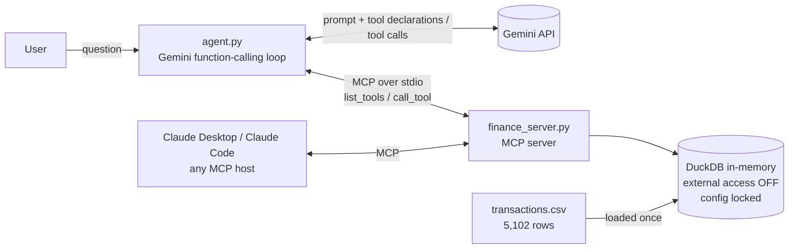

# MCP Server + Agent

**Ask your bank data questions in plain English.**

An **MCP (Model Context Protocol) server** that safely exposes a bank-transactions dataset to LLMs,
plus a **Gemini-powered agent** that uses it to answer questions and hunt for fraud.

**Python** · **MCP Python SDK v2** · **DuckDB** · **Google Gemini API (function calling)** · ~100 MB of dependencies, no local models

```text
> Were there any card-testing attacks in December? Which accounts should we contact first?
  -> find_suspicious_transactions({"rules": ["card_testing"], "start_date": "2025-12-01", "end_date": "2025-12-31"})
Yes, one card-testing attack was detected in December (matched rule `card_testing`, risk score 35).
These are leads for human review, not proven fraud.
Account to contact first: ACC47388792 (user U0165), 6 rapid low-value charges on Steam on 25 Dec 2025:
| TXN0004966 | 2025-12-25 14:30:04 | €1.20 | ... (6 rows)
```
*(Real output from `gemini-3.5-flash-lite`, shortened. Every tool call is printed as it happens.)*

## Why

LLMs are only useful on company data if they can reach it **safely**. MCP is the open standard
(supported by Claude, ChatGPT, Gemini, VS Code, Cursor…) for plugging tools and data into AI
applications. This project builds both sides:

* the **server**: well-described, typed, read-only tools over the data, with guardrails;
* the **client/agent**: discovers the tools over MCP and lets Gemini decide which to call.

Because the server speaks standard MCP, the same server also works unchanged in **Claude Desktop,
Claude Code** or any other MCP host.

## Architecture



## MCP tools

| Tool | What it does |
|---|---|
| `get_schema` | Columns, row count, date range, allowed values of categorical columns |
| `spending_summary` | Total / count / average grouped by category, city, vendor, month, user… with date, user, category and city filters |
| `user_profile` | One customer's totals, home city, accounts, favourite categories, recent transactions |
| `find_suspicious_transactions` | Rule-based fraud screening with a 0–100 risk score and an explanation per flag |
| `query_transactions` | Free-form read-only SQL for anything else (guarded, see below) |

There's also an MCP **prompt**, `fraud_review(month)`, that asks the model for an analyst-style fraud report.
Every tool is annotated `readOnlyHint` so hosts know it has no side effects.

## Security: letting an LLM write SQL safely

The free-form SQL tool is the riskiest one, so it's protected in layers:

1. **Parse, don't regex.** DuckDB's own parser splits the input. Exactly one statement is
   allowed, and it must be a `SELECT`; `DROP`, `DELETE`, `SET`, `ATTACH`, `COPY`… are refused.
2. **No file or network access.** After loading the CSV the server runs
   `SET enable_external_access = false`, so `read_csv('C:/…')`, `httpfs` and similar are blocked even inside a valid `SELECT`.
3. **Locked configuration.** `SET lock_configuration = true` means a query can't switch the setting back on.
4. **In-memory copy.** The database lives in memory, so the original CSV can't be modified.
5. **Bounded output.** At most 200 rows are returned, with a `truncated` flag.

All of this is covered by tests, including trying to read the fraud-label file from SQL.

## Fraud detection, evaluated

The data generator (adapted from my
[Spark transactions project](https://github.com/DP-07dharun/spark-financial-transactions-analysis))
**injects 40 labelled fraud scenarios** into 5,000 normal transactions. The labels go to
`data/anomalies_truth.csv`, which the server never loads, so they're only used for scoring.

| Scenario | Rule(s) that should catch it | Caught |
|---|---|---|
| Amount spike (25–60× normal) | `amount_spike`: > 15× category median | 10 / 10 |
| Card testing (5–8 charges < 2 € in minutes) | `card_testing`: 4+ tiny charges on one account within 10 min | 62 / 62 |
| Large night-time purchase in another city | `night_activity` + `away_from_home` | 10 / 10 |
| Impossible travel (two cities 450+ km apart, minutes apart) | `impossible_travel`: required speed > 500 km/h (faster than a plane) | 20 / 20 |
| **Total** | | **102 / 102 recall · 87.9 % precision** |

The 14 "false positives" are all `impossible_travel` hits on rows from the base generator,
which sometimes places one user's payments in distant cities minutes apart (e.g. Paris -> Lyon
in 14 min, 1,704 km/h). They really are physically impossible journeys, just not labelled as
fraud. Each flag carries its evidence (journey, minutes, speed; amount vs. category median),
so the agent can explain *why* something was flagged.

The whole detector is a single SQL query with window functions (rolling 10-minute counts,
`lag`/`lead` across a user's payments, the haversine distance between cities, and a per-user
home city via `mode()`).

## Run it

Requires Python 3.10+ (developed on 3.14). Everything installs into a local `.venv` (~100 MB).

```powershell
python -m venv .venv
.venv\Scripts\python -m pip install --no-cache-dir -r requirements.txt
.venv\Scripts\python data\generate_transactions.py      # 5,000 rows + 40 fraud scenarios
.venv\Scripts\python -m unittest -v                     # 12 tests, no API key needed
```

**Agent (Gemini):** create a free key at [Google AI Studio](https://aistudio.google.com/apikey),
copy `.env.example` to `.env` and paste it in. Then:

```powershell
.venv\Scripts\python agent\agent.py                                    # chat
.venv\Scripts\python agent\agent.py "Top 3 cities by travel spending in summer?"
```

If the default model isn't available on your key, the agent lists the ones that are; set `GEMINI_MODEL` in `.env`.

**Claude Code / Claude Desktop:** `.mcp.json` registers the server for Claude Code when it's
opened in this folder. For Claude Desktop, add the same entry to `claude_desktop_config.json`, with absolute paths.

**MCP Inspector** (optional, needs Node): `npx @modelcontextprotocol/inspector .venv\Scripts\python server\finance_server.py`

## Project layout

```text
server/finance_server.py   MCP server: data loading, guardrails, 5 tools, 1 prompt
agent/agent.py             Gemini agent: MCP client, tool translation, function-calling loop
data/generate_transactions.py   synthetic data + labelled fraud injection
tests/test_project.py      tools, SQL safety, detection accuracy, MCP protocol, agent loop (fake LLM)
```

## Ideas for next steps

* Serve over **Streamable HTTP** with OAuth and deploy to Cloud Run
* Small React chat UI showing each tool call live
* Replace the rules with an Isolation Forest and compare on the same labels
